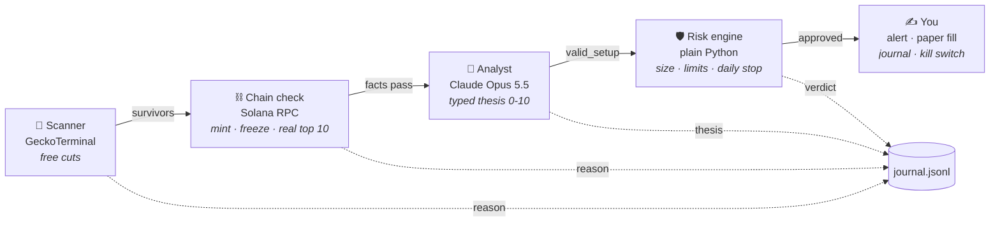

<div align="center">


# The AI Trading Desk

**A bounded sample of new pools. A sampled holder check, not a dev-wallet audit. An optional model scores what survives, code sizes the trade, and paid calls stay off until you configure them.**

[](https://github.com/NickChauvin/ai-trading-desk/actions/workflows/tests.yml)


[](LICENSE)

[Quick start](#-quick-start) · [How it works](#-how-it-works) · [The stack](#-the-full-stack) · [Config](#-config) · [FAQ](#-faq) · [Telegram](https://t.me/+Ykc8YKaJR6Q3NDNk)

</div>

---

> **The AI reads. The code decides. You sign.**
>
> A five-seat paper desk for a sample of pump.fun launches and for US stocks. Each cycle reads at most two pages of GeckoTerminal's newest pools, kills what those rows and a 20-account holder sample can kill, and can ask a model you configure to score the survivors. Code sizes the trade. It never holds a key and never signs a transaction. Paid model calls and Telegram alerts are off unless you turn them on.


## Why

In a study of **832,941** pump.fun launches (May to June 2026), **0.198%** graduated from the bonding curve. Launches that advertised a Telegram graduated at **1.485%**; launches without one at **0.166%**. ([arXiv 2607.02823](https://ideas.repec.org/p/arx/papers/2607.02823.html))


The information that kills a bad trade is public and one click away: the holder tab, the dev wallet, the mint authority, the socials. Humans skip it because it takes 60 seconds and the candle takes 4. A machine doesn't skip.

## ⚡ Quick start

```bash
git clone https://github.com/NickChauvin/ai-trading-desk.git
cd ai-trading-desk
python3 -m venv .venv && source .venv/bin/activate
pip install -r requirements.txt
cp .env.example .env              # paid calls and Telegram stay off until you opt in

make test                         # offline tests, no keys and no network
python demos/offline_demo.py      # invented fixtures, no API keys, no network
make shadow                       # one cycle against an isolated book, not the paper ledger
make paper                        # simulated paper ledger, every 60 seconds
```

Stocks on a free Alpaca paper account:

```bash
make stocks
```

Stop everything, from anywhere:

```bash
touch KILL                        # next cycle: close all, stop
```

## 🧠 How it works


Each seat costs more than the one before it, so each one has to kill harder.



| Seat | File | Job | Model? |
| --- | --- | --- | :---: |
| 🚀 **Scanner** | [`desk/scanner.py`](desk/scanner.py) | At most two pages of GeckoTerminal new pools, then pump.fun / PumpSwap only. Kills on age, liquidity, volume, market cap, trade count and sell ratio. | ❌ |
| ⛓️ **Chain check** | [`desk/chain.py`](desk/chain.py) | Mint and freeze authority, plus concentration inside the largest 20 token accounts. Only known pool/curve programs are removed. Unknown owner data fails closed. | ❌ |
| 🧠 **Analyst** | [`desk/analyst.py`](desk/analyst.py) | Optional. Off until `MODEL` has an explicit model id, prices, and a daily dollar budget. Fills a typed `TokenThesis`. Never "buy". | ✅ |
| 🛡️ **Risk engine** | [`desk/risk.py`](desk/risk.py) | Verdict and score gates, quiet hours, daily loss stop, max positions. Ticket = `min(risk cap, size cap, 2% of pool)`. | ❌ |
| ✍️ **You** | [`desk/broker.py`](desk/broker.py) · [`desk/ops.py`](desk/ops.py) | Paper fills with fees and slippage, rule-based exits, journal, bench, Telegram alerts, kill switch. | ❌ |

### Same token, opposite verdict

On a pump.fun token the biggest holder is often the bonding curve. The desk asks the chain who owns each sampled token account and drops that account only when the owner is positively owned by a known pool or curve program. Unknown programs and missing metadata fail closed. Passing the percentage caps is not a holder-safety certificate.

Holder concentration uses at most the largest 20 token accounts, aggregates balances only inside that sample, and excludes an account only when its owner is positively identified as a known pool or curve program. Unknown or missing owner metadata fails closed. This is not a complete holder census and not a developer-wallet audit.


### The analyst fills a form, not a vibe

```python
class TokenThesis(BaseModel):
    verdict: Literal["skip", "watch", "valid_setup"]   # never "buy"
    score: int                                         # 0-10, clamped in code
    red_flags: list[str]                               # most dangerous first
    green_flags: list[str]
    shape: Literal["crowd", "one_buyer", "fading", "too_early"]
    invalidation: str                                  # what would prove this wrong
    sources: list[str]                                 # input fields it rests on
```

Every string a stranger wrote (token names, links, headlines) reaches the model wrapped as untrusted data. Even a fooled analyst can't size a position or place an order: those jobs belong to code.


### Three caps, the smallest one wins


### Exits: code, not conversation

| Rule | Value |
| --- | --- |
| Stop | -35% from entry |
| Take profit | sell half at 2x, once |
| Volume decay | close when 6h volume < 20% of the 24h pace (after 30 min held) |
| Time out | 24 hours, if a quote is still executable |
| Missing quote | failed exit: holding stays open, cash unchanged, zero-recovery mark |
| No revenge | a closed token sits out 6 hours |

## 🧩 The full stack


The repo ships the core desk. Around it, every tool has one job:

| Layer | Tool | Job |
| --- | --- | --- |
| **Signals** | pump.fun | The venue this desk samples. The scanner does not see every launch |
| | Grok Bot | Reads X 24/7: narratives, project accounts, who's talking |
| | Grok | Quick X lookups on one post or one account |
| | REA | Research seat: deep dives on a narrative |
| **Brains** | Configured model | Optional analyst. Off until you set the id, prices, and budget |
| | ChatGPT | Second opinion. If the two disagree, skip |
| | Jev | Typed yes/no gates with probabilities, in milliseconds |
| **Build + memory** | Claude Code | Builds and fixes the desk |
| | GitHub | Every rule change, versioned |
| | Obsidian | The vault: rules, journal, wallet blacklist, narratives |

Only Claude is wired into the code. The rest sit around it in the workflow: see [`docs/STACK.md`](docs/STACK.md) for the research loop and copy-paste prompts.

## ⚙️ Config

Every number lives in [`config.py`](config.py). Retune there and nowhere else. These are starting values, not advice.

| Group | Key | Default |
| --- | --- | --- |
| Scanner | age window | 10 min to 6 h |
| | min liquidity / 1h volume | $8,000 / $15,000 |
| | market cap window | $25k to $5M |
| | min trades 1h / sell ratio | 120 / 0.15 |
| Chain | max top wallet / top 10 | 5% / 25% |
| | mint or freeze authority | hard no |
| Analyst | model / min score | unset / 7. Paid calls off |
| Risk | risk per trade / max position | 1% / 2% of equity |
| | max share of pool | 2% |
| | aggregate open risk | 3% of conservative equity |
| | daily loss gate / max positions | -3% of the day's starting equity / 3. Not a guaranteed max loss |
| | quiet hours | 01:00 to 07:00 in `DESK_TIMEZONE` (UTC) |

## 💸 What it costs

Paid calls are disabled. This repo does not know which models are offered or what they cost. A call happens only after `MODEL["enabled"]` is true and you have set the model id, input price, output price, output-token cap, and a daily dollar budget from your provider's current docs. Before each request the desk reserves the worst case (input cap + output cap, including retries that may still be billed) against that budget and writes it durably. A failed request is not refunded. Quiet hours, the daily-loss gate, cash, and aggregate open risk are checked before the model is called. The per-cycle count of 3 is an extra limiter, not a dollar cap.

## 📊 Sunday review

```bash
make review          # stats from journal.jsonl
make review-claude   # plus a blunt written review from a cheaper model
```

Read the rejections, not just the trades. They tell you whether your filters cut losers or cut winners. Then change **one** number in `config.py` and run another week.

## 🗂️ Project structure

```
ai-trading-desk/
├── config.py           every threshold
├── run_crypto.py       the loop: scan → chain → analyst → risk → paper
├── run_stocks.py       Alpaca paper, OTO orders with the stop attached
├── review.py           weekly stats + optional Claude review
├── desk/
│   ├── scanner.py      seat 1: GeckoTerminal + DexScreener
│   ├── chain.py        seat 2: Solana RPC facts
│   ├── analyst.py      seat 3: Claude, typed theses, untrusted-input wrapping
│   ├── risk.py         seat 4: pure-code sizing and limits
│   ├── broker.py       seat 5: paper broker + rule-based exits
│   └── ops.py          journal, bench, Telegram, kill switch
├── prompts/            manual mode: the same desk as a Claude Project
├── docs/               architecture, the full stack, research prompts
├── tests/              offline tests, no keys needed
└── assets/             images used in this README
```

## 🔒 Rules this repo will not break

1. No private keys, no signing, no live crypto execution. Ever.
2. The model never sizes a position or places an order.
3. Every third-party string reaches the model wrapped as untrusted text.
4. A missing number is missing, never a pass.
5. A missing or unexecutable quote never books proceeds.
6. Paid model calls and Telegram alerts stay off unless you explicitly enable them.
7. Stocks talk only to an Alpaca paper client. There is no live switch.
8. Paper first. There is no evidence in this repository that the desk is profitable or fit for real money.

## ❓ FAQ

<details>
<summary><b>Can it trade live on Solana?</b></summary>

No. There is no signing code in this repo. A paper alert is a local line unless you set `ALERTS_ENABLED=true`. The signature, if you make one, happens in your own terminal, outside this process.
</details>

<details>
<summary><b>Do I need to know Python?</b></summary>

No. [`prompts/manual-mode.md`](prompts/manual-mode.md) runs the same desk by hand as a Claude Project with a copy-paste prompt pack.
</details>

<details>
<summary><b>Why paper only for weeks?</b></summary>

A good week on paper is noise. A good quarter is a starting point. The journal is how you find out whether the filters work.
</details>

<details>
<summary><b>Will this make money?</b></summary>

No. There is no evidence in this repository that the desk is profitable or fit for real money. Most memecoins go to zero and most strategies lose money, automated ones included. The daily-loss gate only blocks new entries. It does not cap the loss on an open or unresolved holding.
</details>

## Limitations

Bounded sample of GeckoTerminal new pools: at most 2 pages per cycle, whatever page size the API returns (historically 20). Not every launch.

Paper fills are a model, not a market. A missing or unexecutable quote never books proceeds. The holding stays open, cash and realized P&L stay unchanged, and the conservative mark is zero recovery, shown separately from realized loss. Entries are all-or-nothing and must fit in cash, the aggregate open-risk limit, and PAPER['max_liquidity_fraction'] of quoted liquidity. Exits assume PAPER['slippage_pct'] against the trader and PAPER['fee_pct'] of notional, and may fill only up to that liquidity fraction. The unfilled remainder stays open. None of these numbers is an observed execution.

The daily-loss counter uses `DESK_TIMEZONE` (UTC by default), not the host's local clock. It rolls after this process has refreshed quotes, including across a restart: a restart that crosses midnight keeps yesterday's baseline until that refresh, so a stale last price is not booked as the new day's equity. After the roll, new entries can be allowed again even while an unresolved holding is still a total loss. That is why the gate is not a maximum-loss guarantee. Unresolved cost still counts in full toward the aggregate open-risk limit.

Shadow mode journals against a fresh hypothetical account. It does not open or change `paper_ledger.json`.

Alerts print locally. Telegram is used only when `ALERTS_ENABLED` is true and both Telegram variables are set. Stocks refuse any client that is not Alpaca paper. `KILL` stops new entries and attempts simulated exits; it reports holdings that are still open.

There is no evidence in this repository that the desk is profitable or fit for real money.

## 🤝 Contributing

PRs welcome: see [`CONTRIBUTING.md`](CONTRIBUTING.md). Security issues: [`SECURITY.md`](SECURITY.md).

## 📣 Community

Daily alpha, setups and desk updates: **[Telegram](https://t.me/+Ykc8YKaJR6Q3NDNk)**

---

<div align="center">

**Not financial advice.** Paper first. DYOR.

Based on SpikeCalls/ai-trading-desk. License and copyright unchanged.

MIT © SpikeCalls

</div>
