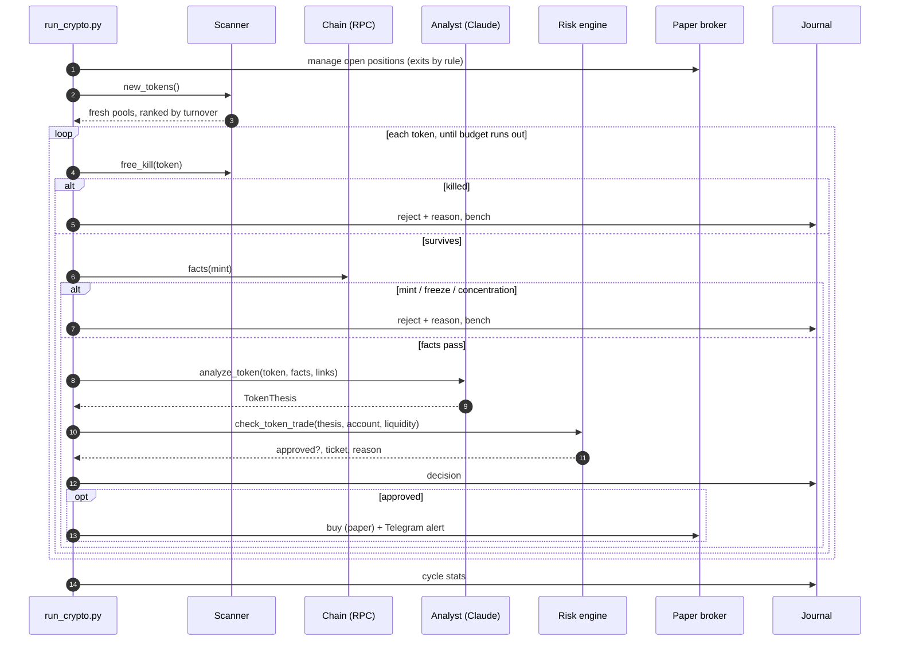

# Architecture

## One cycle (every 60 seconds)

## Budgets

| Resource | Per cycle | Why |
| --- | --- | --- |
| GeckoTerminal | at most 2 new-pool pages | a sample of the newest pools, not every launch. A 429 stops the sample |
| Solana RPC | 8 tokens × 4 calls | public RPC rate-limits fast. Missing data does not pass |
| Model | 3 calls, inside a daily dollar budget | off until model id, prices, and budget are set. Worst-case cost is reserved first |

## Sampled holder concentration

1. `getAccountInfo(mint)` → mint authority, freeze authority, supply, decimals
2. `getTokenLargestAccounts(mint)` → at most 20 token accounts
3. `getMultipleAccounts(token accounts)` → the owner of each
4. `getMultipleAccounts(owners)` → which program owns each owner

System-owned addresses are wallets. Their balances are summed inside the sample. An account is removed only when its owner program is on `KNOWN_POOL_PROGRAMS`, and that exclusion is recorded. Any other program, a missing account, a missing amount, or a zero supply fails closed (`unknown_holder` or `unavailable_concentration`). `developer_wallet_audited` is always false. `coverage_complete` is true only when the sample's balances add up to supply.

## Paper execution

A quote needs a positive price and positive liquidity. Otherwise the exit fails, the position stays, cash and realized P&L do not move, and the conservative equity marks that holding at zero. `KILL` uses the same rule and reports whatever is still open. The daily baseline is an ISO date in `DESK_TIMEZONE`, stored in the ledger. It does not move on a date change until this process has tried a fresh quote for every open position.

## The bench

A rejected token sits out for a time set by **why** it failed: 10 minutes for "too young", 4 hours for "no sells", forever for an open mint authority, 6 hours after any exit. See `BENCH_MINUTES` in `config.py`.
